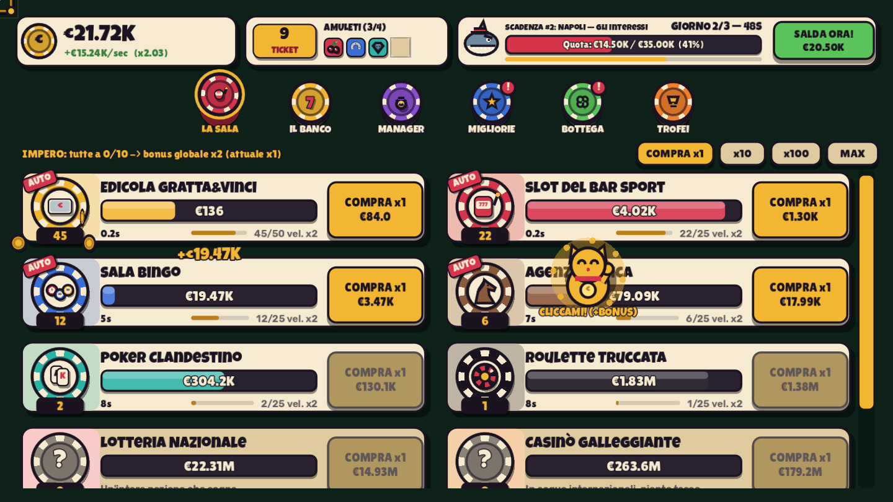
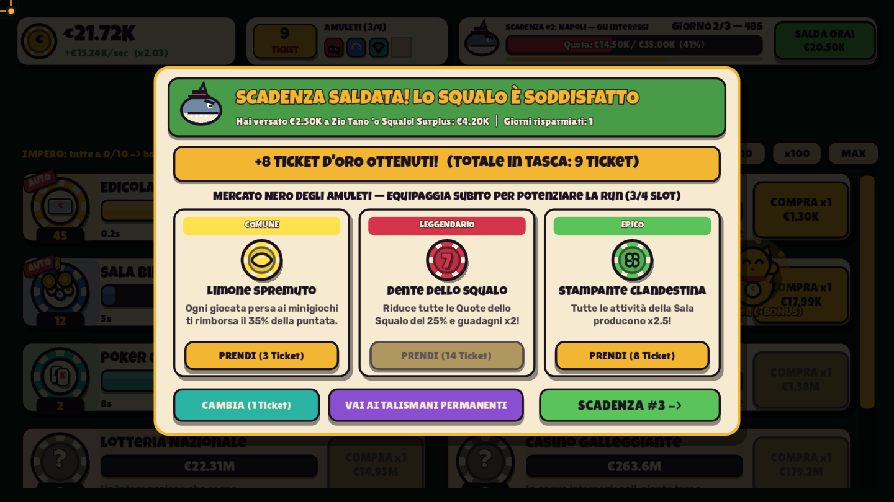
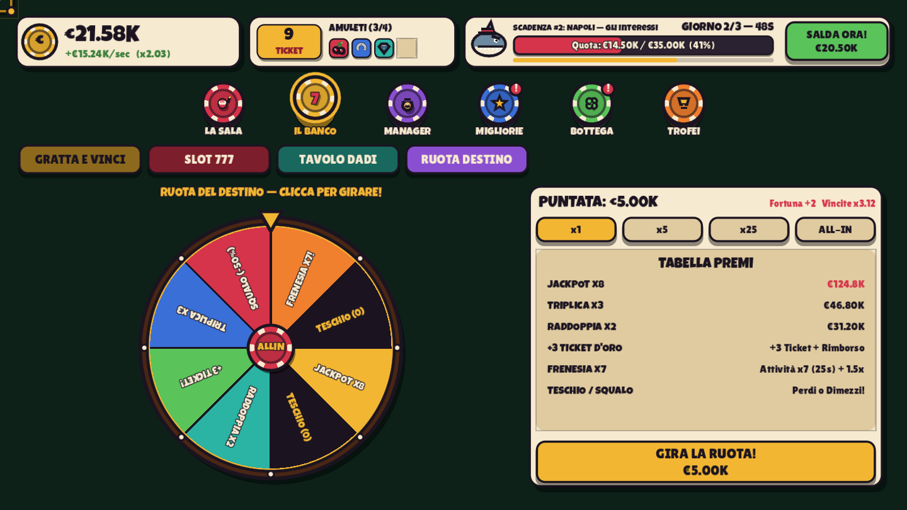
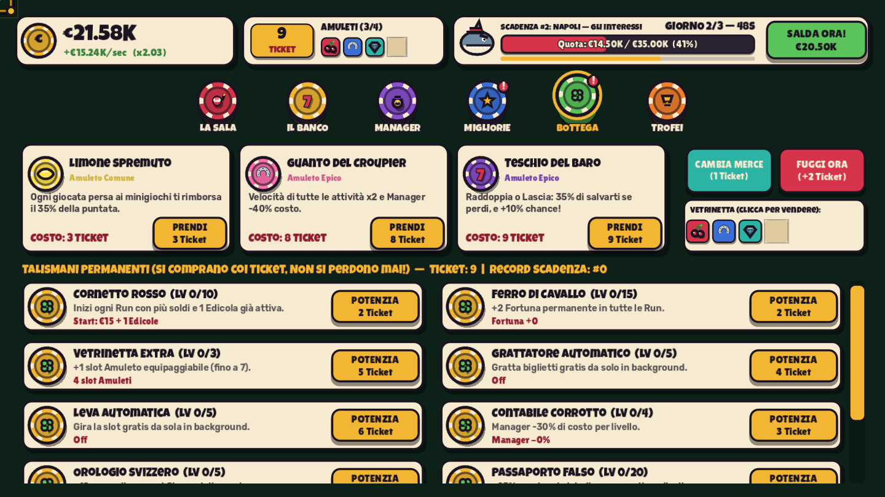
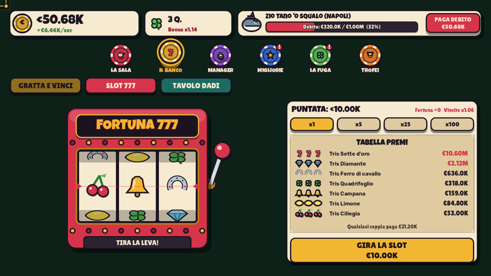
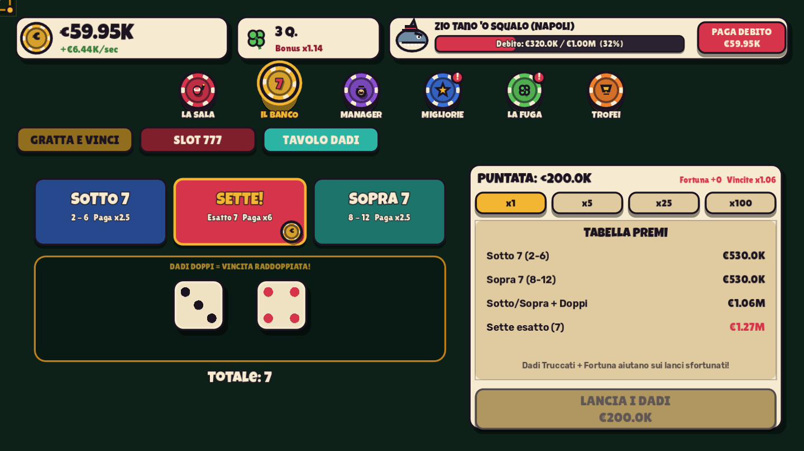

# DEBITO D'ORO (v2.0 — Edizione "Scadenza dello Squalo")

> **Incrementale / Roguelite a tema azzardo** ispirato a *AdVenture Capitalist* e *CloverPit*, realizzato in **Godot 4.3** (GDScript puro, grafica e audio 100% procedurali).
>
> **[⬇ SCARICA L'ESEGUIBILE WINDOWS (.exe dentro lo zip)](https://github.com/MirkoVanzetto/debito-doro/raw/main/build/DebitoDOro-Windows.zip)**

## Novità v2.0 (Loop dinamico stile CloverPit + Streamer Edition)
- **Scadenze a Giorni (Paga o Muori!)**: ogni Scadenza dello Squalo ti dà **3-4 Giorni** (con countdown in tempo reale sulla barra in alto) per versare la Quota. Se scade l'ultimo giorno e non hai abbastanza soldi in cassa, lo Squalo ti pignora la bisca (**Soft Reset della Run**), ma conservi **Ticket d'Oro** e **Talismani Permanenti** per ripartire molto più forte!
- **Ticket d'Oro dal Surplus & Anticipo**: quando saldi una Scadenza, tutti i **soldi guadagnati in più (surplus)** e i **giorni risparmiati** vengono convertiti in **Ticket d'Oro**!
- **Mercato Nero & Vetrinetta degli Amuleti (12 Amuleti con rarità Comune / Raro / Epico / Leggendario)**: tra una Scadenza e l'altra (o nella scheda **Bottega**) puoi spendere i Ticket per equipaggiare Amuleti nella tua Vetrinetta (es. *Magnete da Slot* che triplica i 7, *Dado Piombato* con doppi x4, *Teschio del Baro* che ti salva sul Raddoppia, *Limone Spremuto* che rimborsa il 35% delle giocate perse, *Dente dello Squalo* che taglia del 25% tutte le Quote!).
- **Talismani Permanenti acquistabili coi Ticket**: 9 Talismani che non si perdono mai nemmeno alla morte (*Cornetto Rosso*, *Vetrinetta Extra* fino a 7 slot amuleti, *Grattatore Automatico*, *Leva Automatica*, *Orologio Svizzero*, *Passaporto Falso*, *Dadi Truccati*...).
- **4° Minigioco per Streamer — La Ruota del Destino + Tasto ALL-IN**: gira la ruota a 8 spicchi (*Jackpot x8*, *Triplica x3*, *Raddoppia x2*, *+3 Ticket d'Oro*, *Frenesia x7*, *Squalo -50%* o *Teschio*).
- **Bugfix v2.0**:
  - Risolto il posizionamento delle modali (`StoryModal` e `DeadlineModal`) su qualsiasi risoluzione/finestra ridimensionata.
  - Risolto il click sul **Gatto Dorato Portafortuna**: ora intercetta il click direttamente tramite `_input()` con hitbox maggiorata e alone luminoso in hover, così è sempre cliccabile anche quando passa sopra ai bottoni delle attività.

| Fine Scadenza & Scelta Amuleti | Ruota del Destino (ALL-IN) | Bottega (Amuleti + Talismani) |
|---|---|---|
|  |  |  |

| Gratta e Vinci | Slot 777 | Tavolo dei Dadi |
|---|---|---|
|  |  |  |

## Come giocare
1. Scarica **[`DebitoDOro-Windows.zip`](https://github.com/MirkoVanzetto/debito-doro/raw/main/build/DebitoDOro-Windows.zip)**.
2. Estrai e avvia `DebitoDOro.exe` su Windows (64-bit) — singolo file portatile, zero installazione.
