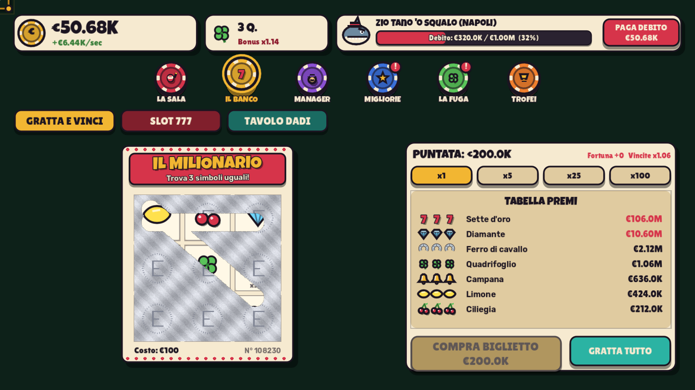

# DEBITO D'ORO

> **Gioco incrementale / idle a tema azzardo** realizzato in **Godot 4.3** (GDScript puro, grafica e audio 100% procedurali).
>
> **[⬇ SCARICA L'ESEGUIBILE WINDOWS (.exe) DALL'ULTIMA RELEASE](https://github.com/MirkoVanzetto/debito-doro/raw/main/build/DebitoDOro-Windows.zip)**


## Trama
Hai perso tutto a poker contro la persona sbagliata: **Zio Tano 'o Squalo**. Gli devi **€1.000.000** e in tasca ti è rimasto solo un biglietto da **€5**.

Gioca tu stesso ai **Gratta e Vinci**, alla **Slot 777** e al **Tavolo dei Dadi**, poi reinvesti le prime vincite per comprare **le tue macchinette e le tue bische**, così a farmare soldi per te sarà la gente che gioca. Ripaga lo Squalo di Napoli... e scopri che a Montecarlo, Las Vegas, Macao, Dubai, sulla Luna e su Marte ti aspettano Squali ancora più grossi (ogni Squalo saldato **triplica per sempre** tutte le entrate!).

| Gratta e Vinci | Slot 777 | Tavolo dei Dadi |
|---|---|---|
|  |  |  |

## Cosa c'è dentro
- **Stile "Tavolo della Bisca"**: panno verde illuminato dalla lampada, bordo in legno con borchie d'ottone, fiches da poker impilate per navigare, carte e biglietti in cartoncino crema con contorno d'inchiostro spesso e ombra netta.
- **10 Attività** da sbloccare e far salire di livello (*Edicola Gratta&Vinci, Slot del Bar Sport, Sala Bingo, Agenzia Ippica, Poker Clandestino, Roulette Truccata, Lotteria Nazionale, Casinò Galleggiante, Crypto-Casinò, Casinò Lunare*).
  - Traguardi a **25 / 50 / 100 / 200 / 300 / 400** che raddoppiano la velocità (fino alla produzione continua) e poi raddoppiano i profitti ogni 100 livelli.
  - **Sinergia d'Impero**: quando tutte e 10 le attività superano la stessa soglia, l'intero impero raddoppia.
- **3 Minigiochi attivi** con puntata che scala col tuo impero (**x1 / x5 / x25 / x100**):
  - **Gratta e Vinci ("Il Milionario")**: si gratta davvero col mouse sulla patina argentata (o col tasto *Gratta Tutto*). Trova 3 simboli uguali fino a **x500**.
  - **Slot Machine "Fortuna 777"**: 3 rulli cilindrici con rallentamento suspense e leva cliccabile, fino a **x1000**.
  - **Tavolo dei Dadi**: punta su *Sotto 7*, *Sette!* (x6) o *Sopra 7*; i dadi doppi raddoppiano la vincita.
  - **Raddoppia o Lascia**: ogni vincita ai minigiochi può essere rimessa in gioco sulla moneta fino a 10 volte di fila.
- **10 Manager** con ritratto illustrato (*Nonna Pina, Er Tasca, Suor Tombola, Fantino Gino, Il Baro, Madame Rouge, Il Notaio, Capitan Fiche, Satoshi Esposito, L'Astronauta*) che automatizzano le attività e lavorano anche **offline**.
- **110+ Migliorie** (per singola attività, globali, moltiplicatori dei minigiochi e Fortuna) con tasto *Compra tutte quelle che puoi*.
- **Prestigio ("La Fuga")**: cambia identità e scappa col bottino per incassare **Quadrifogli d'Oro** (+% globale ciascuno) e spenderli in **9 Talismani permanenti** (*Cornetto Rosso, Ferro di Cavallo, Gatto Nero, Grattatore Automatico, Leva Automatica, Contabile Corrotto, Salvadanaio, Quadrifoglio d'Oro, Dadi Truccati*).
- **Gatto Dorato Portafortuna**: attraversa il tavolo a sorpresa; cliccalo per attivare **Frenesia x7**, **Fortuna Sfacciata x5** o una pioggia di monete.
- **74 Trofei** (+2% permanente a tutti i guadagni per ogni trofeo sbloccato).
- **Audio 100% sintetizzato in codice**: effetti sonori (monete, grattata, rulli, dadi, fanfara jackpot) + sottofondo jazz-lounge procedurale.
- **Salvataggio automatico** ogni 10 secondi + calcolo dei guadagni offline al rientro.

## Come giocare
1. Vai nella sezione **[Releases](https://github.com/MirkoVanzetto/debito-doro/raw/main/build/DebitoDOro-Windows.zip)** e scarica `DebitoDOro.exe` (oppure `DebitoDOro-Windows.zip`).
2. Avvia `DebitoDOro.exe` su Windows (64-bit) — è un **singolo file portatile**, non serve installazione.

### Aprire / compilare il progetto da sorgente
1. Scarica **Godot Engine 4.3** (Standard, GDScript).
2. Apri `project.godot` oppure esporta da terminale:
   ```bash
   godot --headless --export-release "Windows Desktop" build/DebitoDOro.exe
   ```

## Note per lo sviluppo futuro
Vedi [`CONTINUA.md`](CONTINUA.md).
